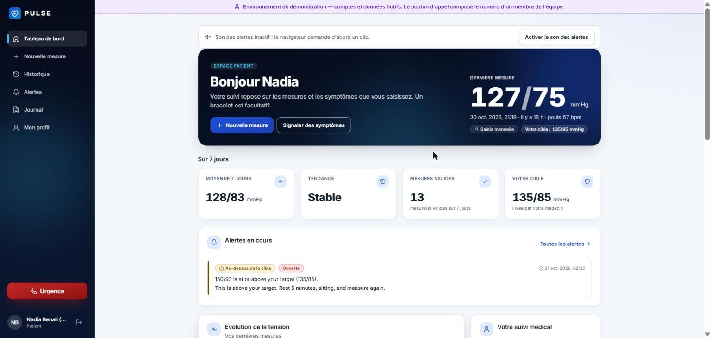
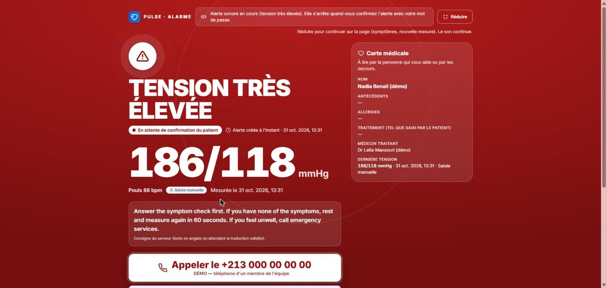
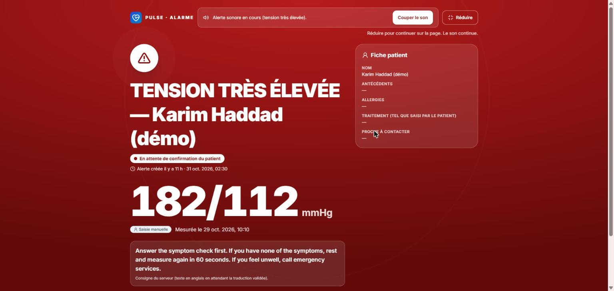
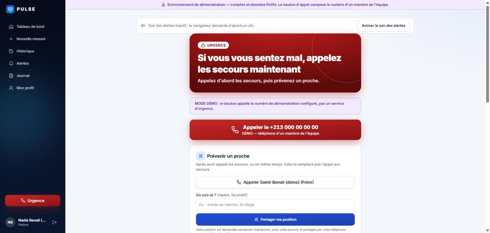
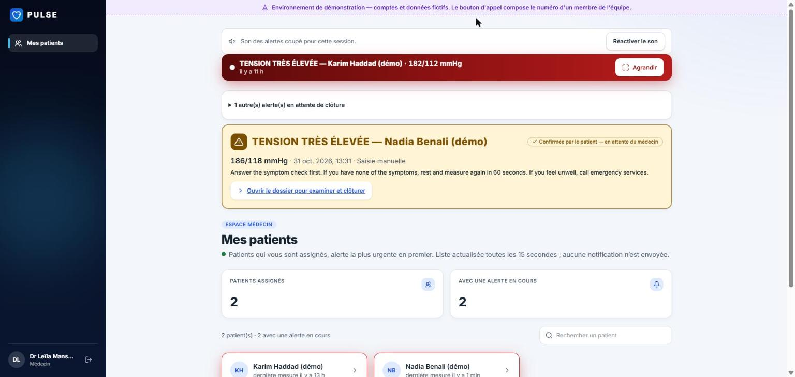
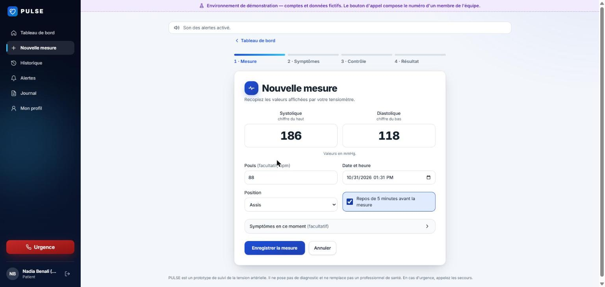
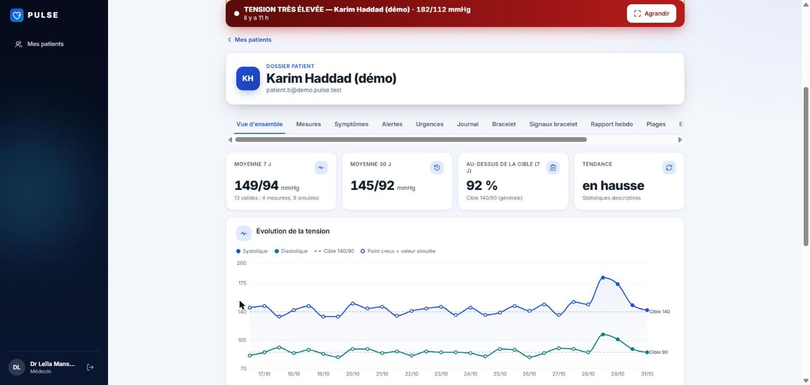
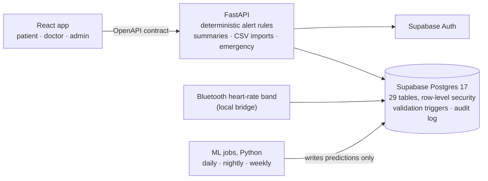

# PULSE

**Between two doctor visits, PULSE keeps watch.**

Hypertension monitoring, early warning and emergency support for Algerian patients and the doctors who follow them.
Built in a 36-hour hackathon by a team of three.

[](https://github.com/Ayoub-Meziani/pulse/actions/workflows/ci.yml)


> **Prototype, not a medical device.** No diagnosis, no medication advice, not clinically validated.
> Every patient shown in this repository is fictional, and simulated data is always labelled as simulated.



## The problem

In Algeria, **31.6 %** of adults aged 18–69 are hypertensive and **41.1 %** of them do not know it
(WHO STEPS survey 2016–2017, Moussouni et al., *BMC Public Health* 2022). Diagnosed patients are seen a few times a
year. In between, home readings stay on paper, patients do not know which number is dangerous or what to do, and the
doctor discovers a bad month at the next visit, sometimes in the emergency room.

## What PULSE does

| | |
|---|---|
| **Measure** | Enter a reading in one screen (two numbers, optional pulse), import a cuff's CSV export, or stream heart rate from a standard Bluetooth band. The database validates every reading and rejects impossible values. |
| **React** | Fixed, tested rules: ≥ 180/120, red-flag symptoms, low pressure. A full-screen alarm rings until the patient confirms with their password, asks about symptoms, starts a 60 s re-check and leads to an emergency screen with a call button, the medical card and a trusted contact (French + Arabic). |
| **Follow** | The doctor sees their patients sorted by urgency and the full record (readings, symptoms, alerts, incidents, journal, notes), sets the target in a care plan, and gets AI help that only doctors can see. |

### Screens

Real screenshots of the running app (French interface, fictional demo accounts).

| Patient | Doctor |
|---|---|
| **Severe reading (186/118):** full-screen alarm, medical card, call button<br> | **Same alert on the doctor's side,** on every page until it is closed<br> |
| **Emergency screen:** call first, then warn a trusted contact<br> | **Patients sorted by urgency;** the patient's confirmation is visible<br> |
| **New reading:** two numbers, optional pulse, "rested 5 minutes"<br> | **Patient record:** averages, trend, simulated points shown hollow<br> |

In demo mode the call button dials a team member's number, never a real emergency service.

### AI that informs the doctor, never decides

Small, explainable models (scikit-learn), documented in [`ml/`](ml/) and [`docs/data/`](docs/data/):

- **Next-day morning blood pressure** (`mbp-v1.1`): 7.88 mmHg mean error on 100 unseen simulated patients, better than
  "same as yesterday" (9.50) on 30 of 30 days; the 90 % interval held 90.7 % of the time.
- **Unusual night** (`ring-v1.1`): compares each night to the patient's own normal; 13 of 14 events found, versus 6 of 14
  with fixed medical limits alone.
- **Early warning** (`live-v1`, built, activation pending review): warns about 17–20 minutes before a ring limit is
  crossed, with about one false alarm per 25 normal nights.
- **Weekly report** (`wcls-v1.1`): risk of being above target next week.
- A model that was too weak on real data (`wrisk-v1`, AUROC 0.60) is **hidden from doctors**, and one that brought no
  gain (`mbp-v2.1`) is not used.

The model proposes a personal range; only the doctor can turn it on. Alerts always come from the deterministic rules
in [`api/app/analysis/rules.py`](api/app/analysis/rules.py), and the emergency flow works with ML switched off.
Results are on simulated patients calibrated with public data (NHANES, a Mendeley home blood-pressure series,
PhysioNet Apnea-ECG): they show the mechanism works, they are not a clinical validation.

### Built for Algeria

Bread portions and salt (bread alone gives about 8–9 g of salt a day), Ramadan fasting days, waist circumference and
the risk factors of the national STEPS survey, birth year only (no full date of birth), a French interface with a
French + Arabic emergency screen, and a call button for the Civil Protection (14).

## Architecture



| Layer | Stack |
|---|---|
| Frontend | React 19, Vite, Tailwind CSS 4, React Router, Recharts ([`frontend/`](frontend/)) |
| Backend | Python, FastAPI, SQLAlchemy, Pydantic ([`api/`](api/)); contract in [`contract/openapi.json`](contract/openapi.json) |
| Database | Supabase (PostgreSQL 17 + Auth); schema only from versioned migrations in [`supabase/migrations/`](supabase/migrations/) |
| Data & ML | pandas, scikit-learn, bleak ([`ml/`](ml/), [`pulse_data/`](pulse_data/)) |
| CI | GitHub Actions: backend tests on two schema versions, contract freshness, frontend lint, tests and build |

Security lives in the database: a doctor only sees their assigned patients, patients cannot read any AI output,
readings cannot be edited after the fact, and public sign-up is closed.

## Safety by design

- Alert thresholds, red-flag symptoms and patient wording were reviewed by the team's medical mentor.
- PULSE never claims a call was made: it records "call button tapped".
- No diagnosis, no prescription, no advice to start, stop or change medication.
- AI output is shown to doctors only and never raises an alert.
- Simulated data cannot be stored unlabelled.

Full rules and limits: [`docs/SAFETY_AND_LIMITATIONS.md`](docs/SAFETY_AND_LIMITATIONS.md).

## Run it locally

Prerequisites: Docker, Python 3.11+, Node.js 22+.

```bash
python scripts/dev_stack.py up          # local Supabase Postgres + Auth (first time)
python scripts/dev_seed.py              # fictional demo accounts; passwords in .dev/demo-credentials.txt
python scripts/dev_api.py               # API  http://127.0.0.1:8000/api/v1/docs
cd frontend && npm ci && npm run dev    # app  http://localhost:5173
```

Everything runs on `127.0.0.1` and never touches the shared cloud project. Details:
[`docs/LOCAL_DEVELOPMENT.md`](docs/LOCAL_DEVELOPMENT.md).

## Tests

Last full run (31 October 2026):

| Suite | Result |
|---|---|
| Backend (`api/`), on the live-equivalent schema and on the latest migrations | 568 passed, twice |
| OpenAPI contract | up to date |
| Frontend (`frontend/`): lint, unit tests, production build | 81 passed, build OK |
| ML (`ml/`) | 36 passed, 7 skipped (need a local database) |
| Data pipeline (`tests/`) | 38 passed, 50 skipped (need a local database) |

Commands: [`docs/LOCAL_DEVELOPMENT.md`](docs/LOCAL_DEVELOPMENT.md#tests).

## Repository layout

```
api/            FastAPI backend: routers, services, deterministic rules (app/analysis/)
frontend/       React app for patients, doctors and admins
supabase/       database config and versioned migrations
ml/             models, training, batch prediction, model cards
pulse_data/     simulator, cuff and ring CSV import, Bluetooth bridge
contract/       generated OpenAPI contract
scripts/        local stack, demo seed, test databases, schema comparison
docs/           conception, API contract, safety, decisions, presentation, data and engineering notes
```

## Documentation

- [`docs/presentation/`](docs/presentation/): jury deck (French, HTML + PDF) and jury briefing
- [`docs/conception.pdf`](docs/conception.pdf): full conception
- [`docs/API_CONTRACT.md`](docs/API_CONTRACT.md): API contract
- [`docs/SAFETY_AND_LIMITATIONS.md`](docs/SAFETY_AND_LIMITATIONS.md): alert rules and what PULSE does not do
- [`docs/decisions.md`](docs/decisions.md): decision log
- [`docs/data/`](docs/data/): data dictionary, schema, sources, demo runbook, data and AI reports
- [`docs/engineering/`](docs/engineering/): architecture, integration contracts, database sync policy, changelogs

## Team

| | Role |
|---|---|
| **Ayoub** ([@Ayoub-Meziani](https://github.com/Ayoub-Meziani)) | Backend, integration, API contract, alerts and emergency flow |
| **ik07072007** ([@ik07072007](https://github.com/ik07072007)) | Frontend: patient, doctor and admin app |
| **Chaboutiar07** ([@Chaboutiar07](https://github.com/Chaboutiar07)) | Data and AI: database, security, simulator, models, Bluetooth bridge |

With the support of a medical mentor who reviewed the alert thresholds, red-flag symptoms, patient wording and AI
settings.

## License

[MIT](LICENSE)
