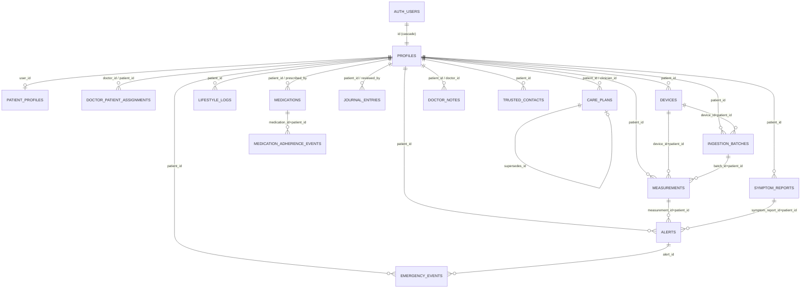

# PULSE database schema (actual)

**Scope:**
- Source of truth: `supabase/migrations/20261029120000_core_schema.sql` and `20261029120100_access_policies.sql`.
- Everything below was read from the live local catalog (Postgres 17, local stack port 55322, read-only queries) on 30 Oct 2026.
- Field meanings, units and the validation policy are in [DATA_DICTIONARY.md](DATA_DICTIONARY.md). The per-role permissions matrix is in [API_CONTRACT.md](API_CONTRACT.md).
- The schema exists **only locally**. No remote Supabase project has it.

## 1. ER diagram

`audit_log` has no foreign keys. It stores `table_name` + `row_id` + `actor`.

**Composite same-patient foreign keys.** Several links are on two columns, `(child_id, patient_id)` → `(id, patient_id)`. This makes it impossible to attach another patient's device, batch, measurement, symptom report or medication. These links are marked `+patient_id` in the diagram.

## 2. Tables, keys and indexes
| table | PK | foreign keys (on delete) | unique / partial indexes | other indexes |
|---|---|---|---|---|
| profiles | id | id → auth.users (cascade) | – | – |
| patient_profiles | user_id | user_id → profiles (cascade); regular_doctor_id → profiles (set null) | – | – |
| doctor_patient_assignments | id | doctor_id, patient_id → profiles (cascade) | `assignments_one_active` (doctor_id, patient_id) where active | (patient_id) where active |
| devices | id | patient_id → profiles (cascade) | (id, patient_id); `devices_external_id` (patient_id, external_device_id) where not null | – |
| ingestion_batches | id | patient_id (cascade); (device_id, patient_id) → devices; created_by (set null) | (id, patient_id); `batches_file_once` (patient_id, file_sha256) | – |
| measurements | id | patient_id (cascade); (device_id, patient_id) → devices; (ingestion_batch_id, patient_id) → batches; created_by (set null) | (id, patient_id); `measurements_device_reading` (device_id, external_id) where not null | (patient_id, measured_at desc) |
| symptom_reports | id | patient_id (cascade) | (id, patient_id) | (patient_id, reported_at desc) |
| lifestyle_logs | id | patient_id (cascade) | – | (patient_id, started_at desc) |
| medications | id | patient_id (cascade); prescribed_by → profiles (restrict) | (id, patient_id) | – |
| medication_adherence_events | id | (medication_id, patient_id) → medications (cascade) | – | (patient_id, reported_at desc) |
| journal_entries | id | patient_id (cascade); reviewed_by (set null) | – | (patient_id, created_at desc) |
| care_plans | id | patient_id (cascade); clinician_id (restrict); supersedes_id → care_plans (set null) | `care_plans_one_active` (patient_id) where active | – |
| doctor_notes | id | patient_id (cascade); doctor_id (restrict) | – | (patient_id, created_at desc) |
| alerts | id | patient_id (cascade); (measurement_id, patient_id) → measurements; (symptom_report_id, patient_id) → symptom_reports; acknowledged_by/reviewed_by/resolved_by (set null) | `alerts_once_per_measurement` (measurement_id, rule_code); `alerts_once_per_symptom_report` (symptom_report_id, rule_code) | (patient_id, status, created_at desc) |
| trusted_contacts | id | patient_id (cascade) | – | – |
| emergency_events | id | patient_id (cascade); alert_id → alerts (set null) | – | (patient_id, started_at desc) |
| audit_log | id | – | – | (table_name, row_id) |

**Totals:** 34 foreign keys and 39 indexes, including primary keys.

## 3. Check constraints (summary)
There are 87 `CHECK` constraints in total. The largest groups are measurements (18), lifestyle_logs (18), care_plans (7), and ingestion_batches and alerts (6 each). They enforce:
- **Controlled vocabularies:** role, source, provenance, method, status, alert class, symptom codes, lifestyle category, and so on.
- **Units:** `unit = 'mmHg'`.
- **Storage bounds:** systolic 1–400, diastolic 1–300.
- **Labelling rules:**
  - A row with `source = 'simulated'` must have `provenance = 'simulated'`.
  - A row with method `wearable_estimate` must have `provenance = 'estimated'`.
- **Category-specific lifestyle columns:** for example, `sodium_mg` requires `sodium_basis`.
- **Time ordering:** for example, `ended_at ≥ started_at`, and lifestyle entries last at most 24 h.
- **Consent rule:** location requires `location_shared_with_consent`.

Physiological plausibility is **not** a check constraint. It lives in the validation trigger, which stores flagged rows instead of refusing them.

## 4. Triggers and functions
All helper functions live in the `private` schema, which the API does not expose. They are `security definer` with `search_path=''`.

| trigger | table | timing | function / purpose |
|---|---|---|---|
| on_auth_user_created | auth.users | after insert | `private.handle_new_user`: creates the profile, always with role `patient` |
| measurements_validate | measurements | before insert/update | `private.validate_measurement`: policy `pulse-v1` sets `validation_status`, `quality_flags`, `validation_policy_version` and `created_by` |
| *_roles | assignments, patient_profiles, medications, care_plans, doctor_notes | before insert/update | `private.enforce_roles`: checks the referenced profile has the correct role (doctor/patient) |
| *_audit | profiles, assignments, medications, care_plans, doctor_notes, alerts | after insert/update/delete | `private.audit`: writes a row to `audit_log` |
| *_touch | profiles, patient_profiles, assignments, lifestyle_logs, medications, care_plans, doctor_notes | before update | `private.touch_updated_at`: refreshes `updated_at` |

**RLS helpers:** `current_app_role()`, `is_assigned_doctor(patient)`, `is_my_doctor(doctor)`, `can_read_patient(patient)`. Timezone validation: `is_valid_tz()`.

## 5. Access control (RLS + grants)
- RLS is enabled on all 17 tables, with 41 policies. Every policy targets the `authenticated` role.
- `anon` has **0** table grants.
- The service role bypasses RLS and is used only by the seed, the import CLI and the future rule engine.

| grant to `authenticated` | tables |
|---|---|
| SELECT only | profiles\*, doctor_patient_assignments, ingestion_batches, alerts, audit_log (admin policy) |
| SELECT, INSERT | measurements (policy: own row, `source='manual'`, not simulated, no batch), symptom_reports, journal_entries\*\*, medication_adherence_events |
| SELECT, INSERT, UPDATE | patient_profiles, devices, medications, care_plans, doctor_notes, emergency_events |
| SELECT, INSERT, UPDATE, DELETE | lifestyle_logs, trusted_contacts |

\* On `profiles`, users can UPDATE only `display_name` and `timezone` (a column grant), so nobody can change their own role.
\*\* On `journal_entries`, UPDATE is limited to the review columns, and only an assigned doctor may use it.

There is no UPDATE or DELETE grant on measurements, symptom reports, adherence events, alerts or assignments. These tables are append-only for app users.

The full matrix of who can do what is in [API_CONTRACT.md](API_CONTRACT.md).

## 5b. Authentication structure
- **Sign-in:** Supabase Auth (GoTrue) with email and password. `auth.users` is managed by Supabase and PULSE does not alter it. Each user's id (`sub` in the access token) equals `profiles.id`.
- **Sign-up:** the trigger `on_auth_user_created` → `private.handle_new_user()` inserts the user's `profiles` row with role `patient`. Sign-up metadata cannot set the role.
- **Roles:** `profiles.role` is `patient`, `doctor` or `admin`. Only the service role or SQL run by the project owner can change it.
  - RLS reads the role through `private.current_app_role()`.
  - Doctors' access comes from active rows in `doctor_patient_assignments`.
- **Not configured:** email confirmation, OAuth providers, MFA and custom JWT claims. The team should decide on these.

## Schema-only export
[export/pulse_schema.sql](export/pulse_schema.sql) contains:
- 17 tables, all keys and indexes, check constraints, the 10 `private` functions, triggers, the 41 RLS policies and the grants
- the auth trigger

It has **no data and no credentials**. Generated with `pg_dump --schema-only --no-owner --schema=public --schema=private`.

Use it for review. To create the schema, apply `supabase/migrations/` instead.

## 6. Connecting the backend safely
1. **Act as the user for user actions.** Use `supabase-js` or REST with the user's access token (JWT). RLS then applies automatically. Do not re-implement access checks in the backend.
2. **Use the service role only server-side**, and only for the writes no user may make: alerts (rule engine), doctor–patient assignments, role changes, ingestion batches/imports, and future ML predictions. Keep the key in server secrets. Never put it in the frontend, the repo or logs.
3. **Use a direct DB connection** (`DATABASE_URL`) only for batch tools (the import CLI, ML jobs). It bypasses RLS, so filter by `patient_id` explicitly.
4. **Migrations are append-only.** Add a new file; never edit an applied one.
   - Apply with `npx supabase@2.122.0 link --project-ref <ref>` then `db push`, run by the agreed owner.
   - Every new table must enable RLS, revoke `anon`, and grant only what it needs. Supabase's default grants are wide open.
5. **Never push `supabase/seed.sql`** to a shared project. It creates demo users with a known password. Never run `db reset` against a linked or remote project.
6. **Keep health values out of logs.** Do not echo request bodies in logs or error messages. Map Postgres error codes (42501, 23514, 23505, 23503) to user messages as listed in API_CONTRACT.md.
7. **Treat the database status as authoritative.** Show `validation_status`/`quality_flags` from the database. Never compute them in the client, and never send them.
